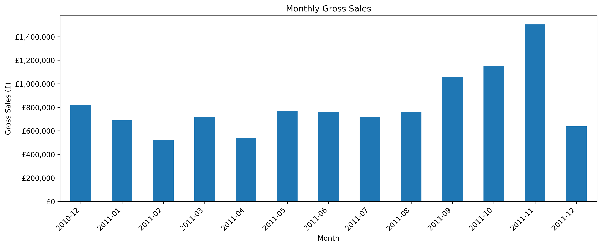
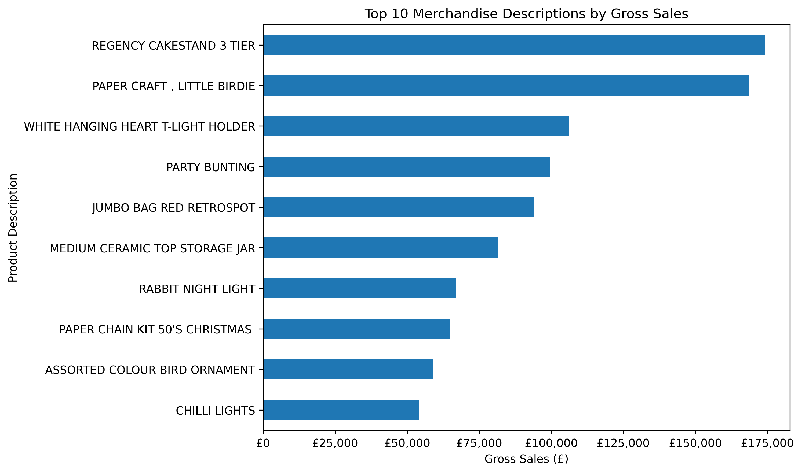
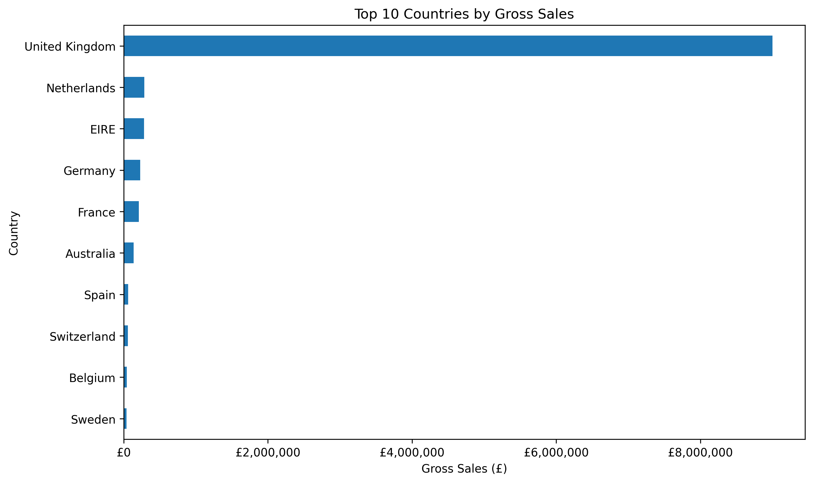

# E-commerce Sales Analysis

A Python-based data analysis project exploring retail sales trends, product performance, and geographical sales distribution using real-world transaction data.

## Project Overview

This project analyzes an online retail dataset containing more than 500,000 transaction records. It uses Python and data analysis libraries to investigate data quality, calculate gross sales, identify trends, and visualize business performance.

The project demonstrates practical skills in data cleaning, exploratory data analysis (EDA), data aggregation, and visualization.

## Objectives

- Analyze monthly gross sales trends.
- Identify top-performing merchandise descriptions by gross sales.
- Compare sales performance across countries.
- Investigate duplicate records, missing values, cancellations, negative quantities, and zero-price transactions.
- Communicate findings through clear visualizations.

## Dataset

**Dataset:** Online Retail  
**Source:** [UCI Machine Learning Repository — Online Retail](https://archive.ics.uci.edu/dataset/352/online+retail)

The dataset contains transactions from a UK-based online retail business between December 2010 and December 2011.

### Dataset Columns

| Column | Description |
|---|---|
| `InvoiceNo` | Transaction invoice number |
| `StockCode` | Product code |
| `Description` | Product description |
| `Quantity` | Number of items in the transaction |
| `InvoiceDate` | Date and time of the transaction |
| `UnitPrice` | Price per item |
| `CustomerID` | Customer identifier |
| `Country` | Customer's country |

### Dataset Setup

The original Excel dataset is not included in this repository.

1. Download the dataset from the UCI Machine Learning Repository.
2. Create a folder named `data` in the project root.
3. Place the downloaded Excel file in that folder and name it `Online Retail.xlsx`.

## Tools and Technologies

- **Python** — Data processing and analysis
- **Pandas** — Data cleaning, grouping, and aggregation
- **NumPy** — Numerical computing
- **Matplotlib** — Data visualization
- **Jupyter Notebook** — Interactive analysis
- **Git and GitHub** — Version control and project hosting

## Project Workflow

### 1. Data Exploration

- Inspected dataset dimensions, column names, data types, and summary statistics.
- Examined missing values and duplicate records.
- Investigated unusual quantities, prices, and transaction descriptions.

### 2. Data Cleaning and Preparation

- Removed exact duplicate records from the working dataset.
- Created a revenue column using quantity multiplied by unit price.
- Identified cancellation invoices using invoice numbers beginning with `C`.
- Investigated negative quantities, missing customer IDs, and zero-price transactions.
- Created a separate sales dataset using positive quantities, positive unit prices, and non-cancellation invoices.

### 3. Exploratory Data Analysis

- Analyzed monthly gross sales.
- Ranked product descriptions by gross sales.
- Compared gross sales across countries.
- Examined transaction records and identifiable customer counts.

### 4. Data Visualization

Created charts using Matplotlib to communicate monthly sales trends, product rankings, and country-wise sales performance.

## Key Findings

- **Monthly sales:** November 2011 recorded the highest monthly value in the initial transaction-level revenue analysis.
- **Country performance:** The United Kingdom led the filtered sales dataset, with approximately £9.00 million in gross sales.
- **Product performance:** Product rankings differ depending on whether products are compared by sales value or quantity.
- **Data quality:** The dataset contains cancellations, negative quantities, zero-price transactions, missing customer IDs, and unusual transaction descriptions.
- **Customer analysis:** Missing customer IDs limit the completeness of customer-level comparisons.
- **Incomplete period:** December 2011 contains partial data, ending on December 9.

These findings reflect the current analysis and filtering rules. Gross sales should not be interpreted as net revenue or profit.

## Visualizations

### 1. Monthly Gross Sales

Shows how gross sales varied across months during the observation period.



### 2. Top 10 Merchandise Descriptions by Gross Sales

Ranks merchandise descriptions by gross sales after excluding selected postage and manual-charge entries.



### 3. Top 10 Countries by Gross Sales

Compares gross sales across the leading countries in the filtered dataset.



## Project Structure

```text
ecommerce-sales-analysis/
├── data/
│   └── Online Retail.xlsx          # Download separately; not committed
├── notebooks/
│   └── 01_sales_analysis.ipynb
├── visualization/
│   ├── monthly_gross_sales.png
│   ├── top_10_products_by_sales.png
│   ├── top_10_merchandise_by_sales.png
│   └── top_10_countries_by_sales.png
├── .gitignore
├── README.md
└── requirements.txt
```

## How to Run the Project

### Prerequisites

- Python 3.x
- Jupyter Notebook or Visual Studio Code
- The Online Retail Excel dataset

### Installation

**1. Clone the repository**

```bash
git clone https://github.com/Ankitha2807/ecommerce-sales-analysis.git
```

**2. Navigate to the project directory**

```bash
cd ecommerce-sales-analysis
```

**3. Install dependencies**

```bash
pip install -r requirements.txt
```

**4. Download the dataset**

Download the Excel file from the [UCI dataset page](https://archive.ics.uci.edu/dataset/352/online+retail) and place it at `data/Online Retail.xlsx`.

**5. Run the notebook**

Open `notebooks/01_sales_analysis.ipynb` in Jupyter Notebook or Visual Studio Code and execute the cells in order.

Ensure that the dataset path used in the notebook matches the location described above.

## Limitations

- Gross sales are calculated from transactions with positive quantities and positive unit prices, excluding invoices marked as cancellations.
- The gross sales measure does not account fully for subsequent returns, refunds, or all transaction adjustments.
- Some non-merchandise charges may remain in the analysis.
- Selected description filters do not classify every possible operational or adjustment entry.
- Missing customer IDs limit customer-level analysis.
- December 2011 is an incomplete month.
- Gross sales are not equivalent to net revenue or profit.

## Future Improvements

- Develop a more detailed returns and cancellations analysis.
- Perform customer segmentation and purchasing-behavior analysis.
- Build an interactive sales dashboard using Power BI or Plotly.
- Explore sales forecasting using time-series methods.

## Author

**Ankitha K N**

Computer Science and Engineering Graduate

[GitHub Profile](https://github.com/Ankitha2807/)

[Project Repository](https://github.com/Ankitha2807/ecommerce-sales-analysis)

---

*Developed as a portfolio project to practice Python, data cleaning, exploratory data analysis, and data visualization.*